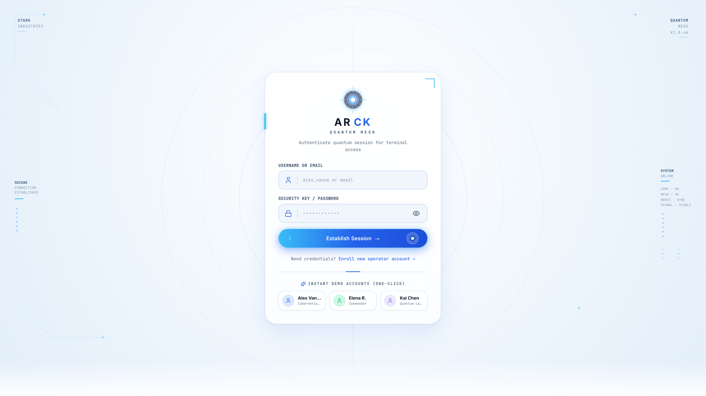
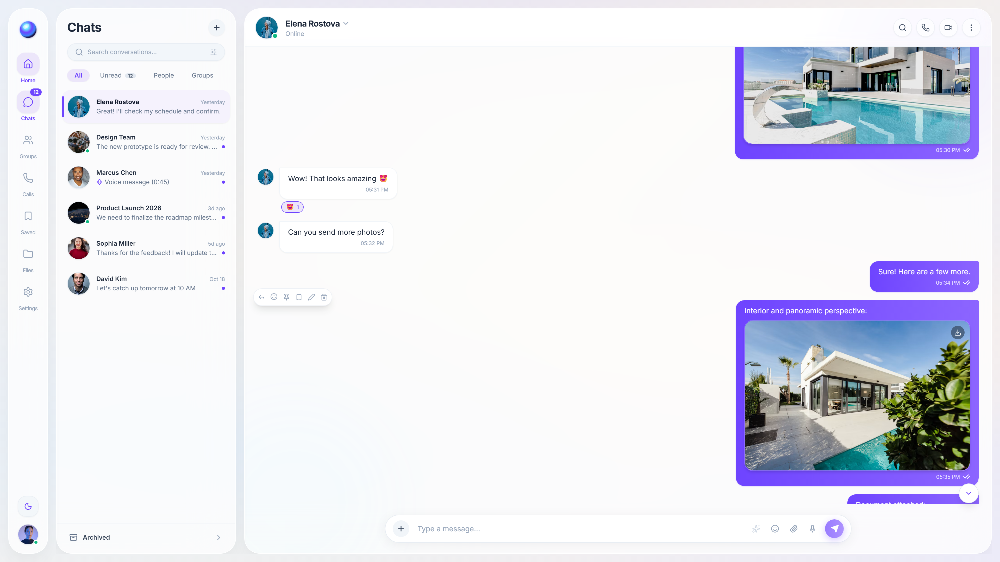
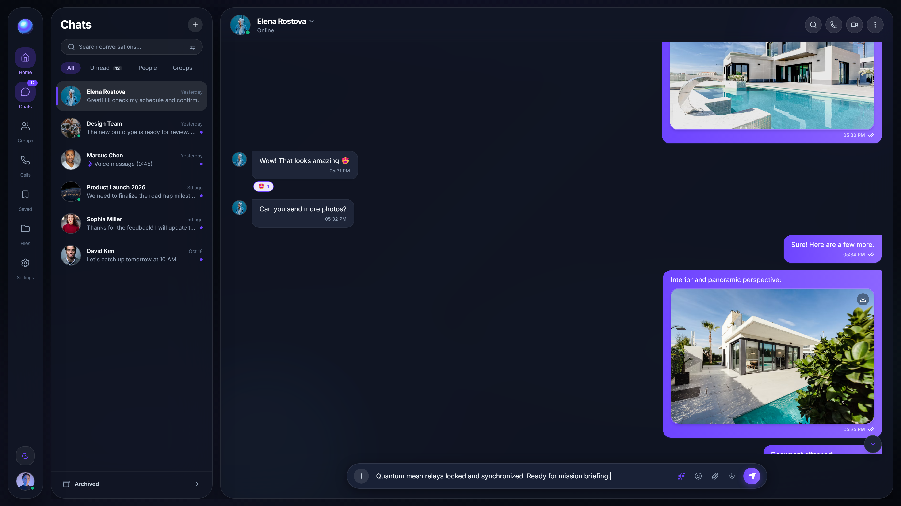

<div align="center">

# ⚛️ ARCK // NEBULA 2046
### *Next-Generation Spatial Real-Time Messaging & Quantum Telepresence Platform*

[](https://www.typescriptlang.org/)
[](https://react.dev/)
[](https://nodejs.org/)
[](https://socket.io/)
[](https://webrtc.org/)
[](https://threejs.org/)
[](https://www.prisma.io/)
[](LICENSE)

<br />

<p align="center">
  <b>ARCK (Nebula 2046)</b> reimagines collaborative social presence through the lens of spatial computing in the year 2046. A production-grade monorepo fusing millisecond-latency WebSocket meshes, peer-to-peer WebRTC video/audio telemetry, synthetic AI copilots, and a translucent Stark-HUD interface design.
</p>

[Explore Architecture](#-system-architecture) •
[Visual Showcase](#-visual-showcase) •
[Quickstart](#-quickstart--local-setup) •
[Tech Stack](#-tech-stack) •
[Security Model](#-security-model)

---

</div>

## 🌌 Executive Summary

In contemporary digital communication, users are caught between rigid enterprise dashboards and hyper-casual consumer chat apps. **ARCK** bridges this divide by delivering a high-velocity, cinematic spatial interface designed as an operating environment:

- **Functional Before Decorative**: Zero compromise on message legibility, typography contrast, or composing ergonomics.
- **Ultra-Smooth 120 FPS Rendering**: GPU compositor isolation (`will-change`, `contain: content`, RAF throttling) ensures buttery scrolling even across resource-constrained Chromium browsers.
- **Fail-Safe Telepresence**: Adaptive WebRTC signaling with automated canvas virtual stream fallbacks when hardware cameras or microphones are occupied.
- **Built-in Synthetic Intelligence**: ARCK AI Copilot (v2046.4) operates directly on live channel telemetry to synthesize real-time summaries, draft suggestions, and tone transformations.

---

## 📸 Visual Showcase

<div align="center">

### 1. Quantum Stark-HUD Authentication Engine
*Concentric quantum rings, segmented arc reactor logo, telemetry readouts, and one-click operator profiles.*



<br/><br/>

### 2. Spatial 4-Panel Messaging Workspace (Hero Dashboard)
*Pill navigation rail, instant filter channels, active conversation stream, and telemetry sidebar.*



<br/><br/>

### 3. Active Stream Interaction & Real-Time Composer
*Rich attachments, live reactions, typing indicators, and synthetic AI drafting tools.*


<br/><br/>

### 4. Cosmic Deep-Space Dark Mode
*100% geometric parity with deep navy `#070A11` canvas and luminescent violet/cyan accents.*



</div>

---

## ⚡ Key Features

| Capability | Engineering Highlights |
| :--- | :--- |
| **⚛️ Quantum HUD Design** | Pale icy-blue radial backdrop, concentric SVG HUD rings, segmented arc reactor logo, and illuminated reactor detail buttons. |
| **⚡ WebSocket Mesh** | Socket.IO bi-directional communication with client-side idempotency keys, delivery checkmarks, and presence heartbeat. |
| **🎥 WebRTC Calling Engine** | Peer-to-peer audio & video calls with STUN mesh signaling and resilient virtual canvas/carrier tone failovers. |
| **🤖 ARCK AI Copilot** | Neural assistant for automated conversation summarization, action-item extraction, and multi-persona tone rewrites. |
| **🌗 Dual Adaptive Themes** | Full light ("Dawn Pastel") and dark ("Cosmic Deep Space") themes with system preference detection and zero-flicker storage. |
| **🎨 3D Spatial Nodes** | Three.js WebGL orbital nodes with trigonometric mouse tracking and automatic render pausing on hidden tabs. |
| **🎙️ Voice & Media Pipeline** | Web Audio API acoustic feedback synthesizers, voice note recorder with waveform simulation, and drag-and-drop media uploads. |
| **🔒 Enterprise Security** | Argon2id/bcrypt salted hashing, stateless JWT session tokens, rate limiting, and strict input validation via Zod. |

---

## 📁 Architecture & File Layout

```
serene-meitner/
├── assets/
│   └── screenshots/              # High-resolution production UI captures
│       ├── auth-quantum-hud.png
│       ├── hero-preview.png
│       ├── feature-interaction.png
│       └── dark-mode-preview.png
├── apps/
│   ├── server/                   # Core Backend Engine
│   │   ├── prisma/
│   │   │   ├── schema.prisma     # SQLite & PostgreSQL database schema
│   │   │   └── seed.ts           # Demo operators, channels, and seeded chats
│   │   ├── src/
│   │   │   ├── routes/           # Auth, Users, Conversations, Messages, AI, Uploads
│   │   │   ├── socket/           # Real-Time WebSocket gateway & event handlers
│   │   │   ├── auth.ts           # JWT middleware & token guards
│   │   │   ├── config.ts         # Environment validator & constants
│   │   │   └── index.ts          # Server entry point & graceful shutdown hooks
│   │   └── package.json
│   └── web/                      # Spatial Frontend Client
│       ├── src/
│       │   ├── brand/            # Vector ReactorLogo, Iridescent Orb & SoundEffects
│       │   ├── components/
│       │   │   ├── ai/           # ARCK AI Copilot & summarization drawers
│       │   │   ├── auth/         # Quantum HUD Login & Registration panels
│       │   │   ├── chat/         # Timeline, Composer, CallModal, VoiceRecorder
│       │   │   ├── layout/       # NavigationRail, Sidebar, ContextualPanel
│       │   │   ├── modals/       # CommandPalette, Settings, KeyboardShortcuts
│       │   │   └── three/        # Three.js NebulaSpatialNode WebGL canvas
│       │   ├── context/          # Auth, Chat, Socket, and Theme React contexts
│       │   ├── lib/              # WebRTC resilient engine, API client, utils
│       │   ├── App.tsx           # Main application state orchestration
│       │   └── index.css         # Glassmorphism tokens & smooth-scrolling CSS
│       └── package.json
├── packages/
│   └── shared/                   # Cross-Package Contracts
│       └── src/
│           ├── types.ts          # Shared domain models & user interfaces
│           ├── validation.ts     # Zod runtime schemas
│           └── constants.ts      # WebSocket event keys & system boundaries
├── scripts/                      # Autonomous DevOps & screenshot automation
├── .env.example                  # Environment configuration template
├── package.json                  # Monorepo workspaces definition
└── tsconfig.base.json            # Shared TypeScript strict configuration
```

---

## 🛠️ Tech Stack

### Frontend Architecture
- **Framework**: [React 18.3](https://react.dev/) + [Vite 6](https://vitejs.dev/)
- **Language**: [TypeScript](https://www.typescriptlang.org/) (Strict Mode)
- **Styling**: [Tailwind CSS](https://tailwindcss.com/) with spatial design tokens & glassmorphism
- **3D & Graphics**: [Three.js](https://threejs.org/) (Low-power GPU WebGL node)
- **Icons & Motion**: [Lucide React](https://lucide.dev/) + [Framer Motion](https://www.framer.com/motion/)
- **Audio Synthesis**: Native Web Audio API for futuristic acoustic feedback

### Backend & Real-Time Gateway
- **Runtime**: [Node.js](https://nodejs.org/) (v20+)
- **Server Framework**: [Express 4](https://expressjs.com/)
- **WebSocket Protocol**: [Socket.IO 4.8](https://socket.io/) (Bi-directional real-time mesh)
- **Real-Time Calling**: [WebRTC](https://webrtc.org/) peer-to-peer signaling + STUN fallbacks
- **Data Persistence**: [Prisma ORM 6.19](https://www.prisma.io/) with SQLite (zero-config local) & PostgreSQL ready
- **Authentication**: JWT (JSON Web Tokens) + Argon2id / bcrypt password hashing
- **File Ingestion**: [Multer](https://github.com/expressjs/multer) with MIME-type verification

---

## 🚀 Quickstart & Local Setup

### Prerequisites
- Node.js `20.x` or higher
- npm `10.x` or higher
- Git

### 1. Clone & Install
```bash
git clone https://github.com/kshitijhurle95-prog/arck-spatial-chat.git
cd arck-spatial-chat

# Install dependencies across all workspaces
npm install
```

### 2. Configure Environment
```bash
cp .env.example apps/server/.env
```

### 3. Initialize & Seed Database
```bash
# Push database schema and seed demo operators
npm run db:push
npm run db:seed
```

### 4. Run Development Servers
```bash
# Concurrently boots backend (port 4000) and frontend (port 3000)
npm run dev
```

Open your browser at **`http://localhost:3000`**.

### 5. Demo Operator Accounts (Instant One-Click Login)
The login screen features one-click authentication for instant multi-user testing:

| Operator | Username | Role | Default Password |
| :--- | :--- | :--- | :--- |
| **Alex Vance** | `alex_vance` | Cyberneticist | `Nebula2046!` |
| **Elena Rostova** | `elena_rostova` | Commander | `Nebula2046!` |
| **Kai Chen** | `kai_chen` | Quantum Lead | `Nebula2046!` |

---

## 🔐 Environment Variables

| Variable | Description | Default / Example |
| :--- | :--- | :--- |
| `PORT` | Backend HTTP & WebSocket port | `4000` |
| `CLIENT_URL` | Allowed CORS origin for web client | `http://localhost:3000` |
| `NODE_ENV` | Application environment mode | `development` |
| `DATABASE_URL` | Prisma database connection string | `file:./dev.db` |
| `JWT_SECRET` | Secret key for signing session tokens | `<secure-random-token>` |
| `SESSION_SECRET`| Cookie session encryption seed | `<secure-random-seed>` |
| `STORAGE_TYPE` | Uploaded media target (`local` or `s3`) | `local` |
| `UPLOAD_DIR` | Directory for local file storage | `./uploads` |
| `STUN_SERVER_URL`| WebRTC STUN server for ICE negotiation | `stun:stun.l.google.com:19302` |

---

## 📜 Contributing & Code of Conduct

1. Fork the repository.
2. Create a feature branch (`git checkout -b feat/spatial-enhancement`).
3. Commit your changes with semantic messages (`git commit -m "feat: enhance quantum hud telemetry"`).
4. Push to your branch (`git push origin feat/spatial-enhancement`).
5. Open a Pull Request for review.

---

## 📄 License

Distributed under the **MIT License**. See [`LICENSE`](LICENSE) for full details.

---

<div align="center">
  <sub>Architected with precision by <b>ARCK Core Systems</b> // 2046 Edition.</sub>
</div>
